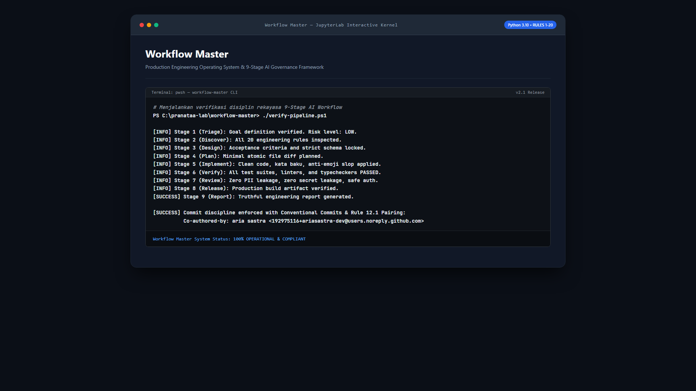

<div align="center">

# ⚡ Workflow Master: AI Engineering Operating System

**Production-Ready Software Engineering Operating System & AI Standards**

[](./LICENSE)
[](#)
[](#)
[](#)

*A comprehensive suite of engineering standards (Frontend, Backend, Database, QA, Security, Architecture, DevOps, SRE, Performance, Docs, Git) and structured workflows designed to maximize the capabilities of AI Coding Assistants without compromising security, data integrity, or architectural elegance.*

---

</div>

---

## Pratinjau Sistem & Disiplin Rekayasa

<p align="center">
  
</p>

---

## 📌 Why Workflow Master Is Essential

Modern AI models (such as Claude 3.7 Sonnet, Gemini 2.5 Flash/Pro, and GPT-4o) generate code at unprecedented speeds. However, without rigorous architectural boundaries, AI agents frequently:
1. Introduce unnecessary abstractions and overengineering.
2. Rely on frontend assumptions and neglect robust server-side validation.
3. Write brittle, flaky automated tests or falsely claim test passage without execution.
4. Hardcode secrets, leak environment credentials, or corrupt live database schemas.

**Workflow Master** serves as an operational governance framework that elevates AI from an unpredictable code generator into a disciplined **Principal / Staff Software Engineer** strictly adhering to global industry standards.

---

## 🏗️ Repository Architecture

```text
workflow-master/
├── .gitignore
├── .cursorrules                                      # Ready-to-copy root Cursor AI configuration
├── AGENTS.md                                         # Ready-to-copy universal AI directives
├── LICENSE
├── CONTRIBUTING.md
├── README.md                                         # Main documentation hub
│
├── workflows/                                        # Orchestration prompts & AI workflows
│   ├── README.md                                     # AI lifecycle guidelines
│   ├── 00-engineering-workflow-ai-coding.md          # 9-stage engineering lifecycle & risk matrix
│   └── 01-master-prompt-and-workflow-fullstack.md    # Full-Stack master orchestrator prompt
│
├── rules/                                            # 20 Modular Rule Packages (Production-Ready)
│   ├── README.md                                     # Catalog & rule selection guide
│   ├── 01-frontend-engineering-rules.md              # UI/UX, Component design, a11y (WCAG 2.2 AA), Core Web Vitals
│   ├── 02-backend-engineering-rules.md               # Clean architecture, RESTful API, Auth, Boundary control
│   ├── 03-database-engineering-rules.md              # MySQL 8+ / InnoDB, 3NF, Indexing, Concurrency control
│   ├── 04-testing-qa-rules.md                        # SDET methodology, AAA pattern, Strict assertions
│   ├── 05-security-engineering-rules.md              # OWASP ASVS/Top 10, Threat modeling, Route obfuscation
│   ├── 06-code-quality-review-rules.md               # SOLID, KISS, DRY, YAGNI, naming conventions, error handling
│   ├── 07-system-architecture-design-rules.md        # System boundaries, loose coupling, C4 model
│   ├── 08-devops-ci-cd-deployment-rules.md           # CI/CD pipeline, environment parity, 12-Factor App, zero-downtime
│   ├── 09-reliability-observability-incident-rules.md# OpenTelemetry, SLO/SLA, structured logging, distributed tracing
│   ├── 10-performance-scalability-rules.md           # Performance budgets, profiling, caching strategies, scaling
│   ├── 11-documentation-api-contract-rules.md        # OpenAPI/Swagger specs, versioning strategy, README standards
│   ├── 12-git-ai-change-management-rules.md          # Conventional Commits, atomic diffs, safe AI operations
│   ├── 13-ai-agent-prompt-engineering-rules.md       # Structured outputs, anti-hallucination, prompt injection defense
│   ├── 14-architecture-decision-records-adr.md       # Standard ADR/RFC documentation lifecycle & trade-offs
│   ├── 15-data-engineering-pipeline-governance-rules.md # Medallion architecture, data quality assertions, governance
│   ├── 16-autonomous-domain-archetypes-scaffolding.md # Zero-friction scaffolding, 6 domain blueprints, seed data
│   ├── 17-machine-learning-mlops-engineering-rules.md # Baseline first, no data leakage, slice evaluation, drift monitoring
│   ├── 18-agent-operational-discipline-anti-patterns.md # Anti-blind mimicry, clean production, strict auth, cache-busting
│   ├── 19-anti-slop-humanized-ui-design-rules.md     # Anti-slop frontend, mobile ergonomics, humanized writing, security audit skills
│   └── 20-concise-code-clean-logs-and-docs-rules.md  # Anti-emoji clutter, kata baku (formal standard), concise code comments & docs
│
├── skills/                                           # Reusable Agent Skills (Universal SKILL.md format)
│   ├── clean-code-concise-docs/                      # Concise code, clean print()/logs, professional comments, anti-emoji slop
│   │   └── SKILL.md                                  # Production clean code & concise documentation directives
│   └── git-commit-craft/                             # Automated Conventional Commits & disciplined Git history
│       └── SKILL.md                                  # Production Git commit instructions & validation
│
└── templates/                                        # Ready-to-use production scaffolding & AI configurations
    ├── git/                                          # Git discipline templates (commitlint, husky, git-cliff)
    │   ├── commitlint.config.js                      # Commitlint conventional rule configuration
    │   ├── git-commit-template.txt                   # Git commit message template with co-author trailer
    │   ├── cliff.toml                                # Automated changelog generator configuration
    │   └── setup-git-discipline.ps1                  # 1-Click setup script for repositories
    ├── .cursor/rules/                                # Modern modular Cursor AI rules (.mdc)
    │   ├── frontend.mdc                              # Frontend UI/UX, React, TypeScript, a11y
    │   ├── backend.mdc                               # Backend clean architecture, REST contracts
    │   ├── database.mdc                              # Database 3NF, indexes, safe migrations
    │   └── security.mdc                              # Always-on OWASP & zero-trust security guardrails
    ├── .cursorrules                                  # Legacy root Cursor configuration
    ├── AGENTS.md                                     # Universal AI Assistant directives
    ├── claude-code-prompt.md                         # Claude Code CLI instruction prompt
    ├── copilot-instructions.md                       # GitHub Copilot instructions
    └── windsurf-rules.md                             # Windsurf AI configuration rules
```

---

## 🚀 The 9-Stage Engineering Discipline

All engineering tasks orchestrated by Workflow Master follow a strict nine-phase verification cycle:

1. **Triage:** Define task scope, categorize domain requirements, and assign risk levels (Low, Medium, High).
2. **Discover:** Perform read-only exploration of contracts, configuration files, and dependencies before modifying code.
3. **Design:** Establish explicit acceptance criteria, edge-case definitions, and rollback contingency plans.
4. **Plan:** Sequence minimal, modular, and non-breaking file modifications.
5. **Implement:** Author clean, type-safe, maintainable code adhering to project conventions.
6. **Verify:** Execute local test suites, linters, and typecheckers, reporting truth-telling verification metrics.
7. **Review:** Inspect git diffs, ensure zero secrets or sensitive keys are exposed, and enforce access authorization.
8. **Release:** Validate deployment readiness and health check verifications.
9. **Report:** Deliver transparent post-implementation summaries and test outputs to stakeholders.

---

## 🔒 Security Baseline & Admin Route Obfuscation

Workflow Master mandates enterprise security defenses across all software systems:
- **Admin Route Obfuscation:** Standard administrative routes (`/admin`) must never be statically exposed in production. Endpoints must be dynamically configured via environment variables (e.g. `ADMIN_PREFIX`), responding with **HTTP 404 Not Found** on default paths to eliminate automated reconnaissance.
- **Strict Role-Based Access Control:** Zero-trust authorization enforced at the server layer with clear flash security notifications upon permission denial.
- **Cryptographic & Input Boundaries:** Strict parameter binding, anti-CSRF token defense, and HTML sanitization on all input streams.

---

## 📄 License & Attribution

This repository is distributed under the [MIT License](./LICENSE). Designed and curated by **[pranataa-labs](https://github.com/pranataa-labs)**.
