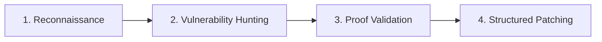

# 19 — Anti-Slop Web Design, Mobile-First Ergonomics, Humanized Writing & Agent Security Audit Rules

**Versi:** 1.0  
**Peran AI:** Lead Product Designer, Mobile UX Specialist, Application Security Auditor & Meta-Prompt Engineer  
**Cakupan:** Panduan rekayasa antarmuka web anti-generik (*anti-slop*), ergonomi layar ponsel (*mobile-first*), standar penulisan manusiawi tanpa klise bot (*humanized writing*), serta protokol audit keamanan mandiri (*security audit skills*) untuk AI Coding Assistant.  
**Tujuan:** Mengeliminasi tampilan antarmuka yang terlihat seragam/murahan akibat kebiasaan bawaan model AI (*AI aesthetic slop*), memastikan kenyamanan navigasi satu tangan pada smartphone, menghilangkan gaya bahasa kaku khas mesin, dan memperkuat postur keamanan kode secara otomatis.

---

## 1. Anti-Slop Web Design Manifesto (Eliminasi UI Generik)

AI coding assistant cenderung memproduksi antarmuka yang jatuh pada titik "rata-rata statistik internet": gradien ungu-biru neon yang sama, susunan 3 kartu identik (*3-column card grid*), font Inter di setiap teks, serta border bertumpuk (*nested card borders*). 

Desain berstandar produksi **WAJIB** memiliki karakter (*taste, craftsmanship, and domain identity*):

### 🚫 7 Dosa Estetika AI (*Banned AI Aesthetics*)
1. **Dilarang Neon Purple / Violet Gradient Hero Overload:** Jangan gunakan latar belakang gradien ungu-violet kebiruan kecuali secara spesifik diwajibkan oleh identitas brand. Gunakan palet berkarakter: slate-oklch yang tenang, monokrom kontras tinggi, earth-tone hangat, atau aksen warna tunggal yang tegas (*bold editorial accents*).
2. **Dilarang Susunan 3 Kartu Identik (*Cookie-Cutter Card Grid*):** Hindari membagi bagian fitur menjadi 3 kartu seragam dengan ikon melingkar kecil di bagian atas. Variasikan ritme visual dengan **Bento Grid** asimetris, perbandingan horizontal, daftar bernomor editorial, atau kartu berbobot visual berbeda (*visual hierarchy*).
3. **Dilarang Kartu di Dalam Kartu (*Nested Card Border Bloat*):** Hindari membungkus elemen dalam kotak bergaris, lalu memasukkannya lagi ke dalam kontainer bergaris lain (`border border-slate-200` bersarang). Gunakan *whitespace*, pemisah garis tipis halus (*subtle divider*), atau perubahan kontras latar belakang lembut (*subtle surface tinting*) sebagai gantinya.
4. **Dilarang Monokultur Tipografi (Overuse of Inter):** Jangan gunakan satu font yang sama untuk semua hierarki. Pasangkan font judul yang berkarakter kuat (*Display/Headings* seperti *Plus Jakarta Sans*, *Outfit*, *Syne*, *Clash Display*, *Playfair Display*, atau *Manrope*) dengan font badan teks yang bersih (*Inter*, *Geist*, *IBM Plex Sans*).
5. **Dilarang Floating Blur Blobs Tanpa Arah:** Hindari menaruh lingkaran gradien buram (*floating ambient blur glow*) di latar belakang secara acak hanya untuk mengisi kekosongan.
6. **Wajib Root Overflow Clipping:** Selalu pasang `overflow-x: clip` pada root container utama halaman web untuk mengeliminasi celah geser horizontal liar (*unwanted horizontal scrollbar*) pada perangkat layar sentuh.
7. **Wajib Status Lengkap (Zero Broken States):** Setiap komponen UI harus memiliki status komprehensif: *Skeleton Loading* (bukan hanya spinner kaku), *Empty State* yang informatif dengan CTA, *Error Boundary* ramah pengguna, serta status interaktif (*focus-visible*, *hover*, *active*).

---

## 2. Mobile-First & Handphone UI/UX Ergonomics

Masyarakat modern mengakses website mayoritas dari layar ponsel (360px – 430px). Antarmuka web tidak boleh sekadar "bisa mengecil", melainkan harus **dirancang khusus untuk interaksi jempol (*thumb-driven navigation*)**:

### 📱 Prinsip Ergonomi Layar Sentuh Handphone
1. **Touch Target Minimal (Fitts's Law):**
   - Ukuran elemen yang dapat diklik (tombol, tautan, ikon) **WAJIB minimal 44 × 44 pt / px** (standar Apple Human Interface Guidelines) atau **48 × 48 dp / px** (standar Google Material Design 3).
   - Berikan *padding hit-area* transparan jika ikon visual berukuran kecil (misal ikon 20px dibungkus tombol dengan padding minimal `p-3`).
2. **The Thumb Zone (Zona Jangkauan Jempol Bawah):**
   - Tempatkan aksi penting di 1/3 bagian bawah layar: bilah navigasi bawah (*Bottom Navigation Bar*), tombol aksi melayang (*Floating Action Button / Sticky Bottom Bar*), dan tombol utama checkout/konfirmasi.
   - Hindari menempatkan tombol aksi krusial di pojok kiri atas atau kanan atas yang memaksa pengguna meregangkan jari atau menggunakan dua tangan.
3. **Bottom Sheet vs Desktop Modal:**
   - Pada layar handphone (`< 768px`), ganti modal dialog popup tengah yang kaku dengan **Bottom Sheet** yang meluncur dari bawah dan mendukung gestur swipe-down untuk menutup.
4. **Dukungan Penuh Safe Area Insets (Notch & Home Bar):**
   - Selalu atur meta tag viewport:
     ```html
     <meta name="viewport" content="width=device-width, initial-scale=1.0, viewport-fit=cover">
     ```
   - Terapkan safe-area insets pada elemen fixed atau sticky:
     ```css
     padding-top: max(1rem, env(safe-area-inset-top));
     padding-bottom: max(1rem, env(safe-area-inset-bottom));
     ```
5. **Fluid Typography & Fluid Spacing:**
   - Gunakan fungsi CSS `clamp()` untuk ukuran font dan padding judul agar mengecil dengan mulus tanpa memotong kata atau memicu *Cumulative Layout Shift (CLS)*:
     ```css
     font-size: clamp(1.75rem, 4vw + 1rem, 3.25rem);
     ```
6. **Responsive Matrix Verification:**
   - Wajib diuji pada ukuran: **360px** (ponsel kecil), **390px** (iPhone standar), **414px/430px** (ponsel Max), **768px** (tablet), dan **1280px+** (desktop).

---

## 3. Humanized Writing & Natural Communication (De-AI-ifying)

*Diadaptasi dari standar `blader/humanizer` dan Wikipedia "Signs of AI writing".*

Teks tombol, microcopy UI, pesan konfirmasi, artikel, dan dokumentasi yang dihasilkan AI sering kali terkesan hampa, kaku, dan bertele-tele. Terapkan prinsip penulisan manusiawi (*humanized voice*):

### 🚫 Frasa & Retorika Terlarang (*Banned AI Tropes*)
1. **Dilarang Frasa Pembuka Berlebihan:**
   - ❌ *"In today's fast-paced digital landscape..."*
   - ❌ *"In the realm of modern technology..."*
   - ❌ *"Delve into the intricacies of..."*
   - ❌ *"A testament to our unwavering commitment..."*
   - ❌ *"Unleash the full potential of..."*
2. **Dilarang Rumus Retorika Klise:**
   - ❌ Konstruksi *"Not only X, but also Y"* atau *"It's not just a product, it's a revolution."*
   - ❌ Pengantar dramatis buatan: *"Here's the thing:"*, *"Let that sink in."*
   - ❌ Triad kata sifat yang dipaksakan (*forced triads*): *"seamless, robust, and intuitive."*
3. **Dilarang Kalimat Penutup Puitis Hampa (*Empty Profundity*):**
   - ❌ *"As we look to the horizon, the journey has just begun."*
   - ❌ *"Serving as a beacon of innovation."*

### ✅ Kaidah Tulisan Manusiawi:
- **Langsung pada Fakta & Nilai Nyata:** Jelaskan apa yang dilakukan fitur, bagaimana cara kerjanya, dan apa manfaat langsung bagi pengguna.
- **Ragam Bahasa Natural & Ringkas:** Gunakan kalimat aktif, kata kerja konkrit, dan bahasa percakapan profesional (*clear, concise, authentic prose*).

---

## 4. Autonomous Security Audit Skills Integration

*Diadaptasi dari `cloudflare/security-audit-skill` dan OWASP Agentic Security Standards.*

Sebelum merilis perubahan antarmuka atau endpoint backend, AI Agent **WAJIB** menjalankan protokol audit keamanan internal 4-fase:



1. **Fase 1 — Surface Reconnaissance:**
   - Petakan semua titik masuk publik: rute admin tersembunyi, parameter query, upload handler, dan middleware CORS.
   - Pastikan header keamanan standar terpasang: `Content-Security-Policy`, `X-Frame-Options: DENY`, `X-Content-Type-Options: nosniff`.
2. **Fase 2 — Vulnerability Hunting (OWASP Top 10):**
   - **Injeksi & XSS:** Periksa apakah input pengguna dieksekusi mentah di DOM atau query SQL.
   - **IDOR / Broken Access Control:** Verifikasi apakah `user_id` atau `resource_id` dapat dimanipulasi oleh sesi pengguna lain.
   - **CSRF & Token Validation:** Pastikan seluruh mutasi state (POST, PUT, DELETE) mewajibkan token valid.
   - **Hardcoded Secrets:** Pindai kode dari kemungkinan token API, private key, atau database password yang tidak sengaja tertulis.
3. **Fase 3 — Candidate Validation (Zero False-Positives):**
   - Uji temuan celah keamanan dengan melacak aliran data dari sumber (*source*) ke titik eksekusi (*sink*) sebelum melaporkan.
4. **Fase 4 — Structured Patching & Verification:**
   - Terapkan perbaikan langsung pada baris kode yang rentan dan sertakan unit test/integration test pencegah regresi (*regression test*).

---

## 5. Direktori Tooling & Agent Skills Terverifikasi

Gunakan dan integrasikan repositori / skill berikut untuk memperkaya kapabilitas AI:

| Tool / Skill | Repositori / Sumber | Fungsi & Kapabilitas |
|---|---|---|
| **Hallmark** | `Nutlope/hallmark` | Anti-AI-slop design skill untuk Claude Code & Cursor (`npx skills add nutlope/hallmark -g`). Memiliki fitur `sloplint`, `redesign`, `audit`, dan `study`. |
| **Humanizer** | `blader/humanizer` | Agent skill berbasis standar Wikipedia untuk membersihkan teks dari tanda-tanda tulisan AI (*de-AI-ifies text*). |
| **Anti-Slop Guidelines** | `miqdadbadjuber/anti-slop` | Katalog aturan sistem untuk mencegah boilerplate UI generik dan kode AI berulang. |
| **Impeccable** | `paulbakaus/impeccable` | Tooling & skill frontend design dengan perintah audit `/audit`, `/polish`, dan `/normalize`. |
| **Security Audit Skill** | `cloudflare/security-audit-skill` | Skill audit keamanan multi-fase profesional untuk coding assistants. |
| **Responsive & Mobile UI** | `wshobson/agents (responsive-design & mobile-ui)` | Playbook teruji untuk mobile-first breakpoint, touch targets, dan layout layar handphone. |

---

## 6. Checklist Pre-Flight Rule 19

Sebelum menyatakan pekerjaan UI atau penulisan selesai, AI **WAJIB** memvalidasi:
- [ ] **Anti-Slop:** Apakah antarmuka bebas dari gradien ungu klise, 3 kartu identik, dan font Inter seragam?
- [ ] **Root Clipping:** Apakah `overflow-x: clip` sudah terpasang pada kontainer utama?
- [ ] **Touch Targets:** Apakah seluruh tombol dan area klik berukuran minimal 44×44px / 48×48px?
- [ ] **Thumb Zone:** Apakah tombol aksi utama berada di area yang mudah dijangkau jempol (bawah layar)?
- [ ] **Safe Area:** Apakah notch dan home indicator bar sudah diperhitungkan dengan `env(safe-area-inset-*)`?
- [ ] **Humanized Copy:** Apakah teks copy bebas dari frasa klise AI seperti *"delve"*, *"testament to"*, atau *"in today's world"*?
- [ ] **Security Sanitization:** Apakah seluruh input form terlindungi dari XSS, CSRF, dan injeksi?
